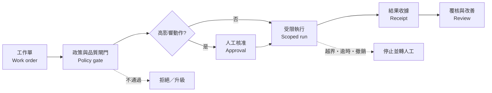

  

  
  
  
  

  <a href="#快速開始">快速開始</a> ·
  <a href="docs/architecture.md">架構</a> ·
  <a href="docs/work-order-lifecycle.md">工作單生命週期</a> ·
  <a href="docs/quality-gates.md">品質閘門</a> ·
  <a href="docs/receipts-and-audit.md">收據與稽核</a>

# AOGF：AI 代理營運治理框架

**讓 AI 代理動到生產系統之前，先有範圍、有人核准、有停止條件；動完之後，留下可以覆核的紀錄。**

AOGF（Agent Operations Governance Framework）是一套**不綁定模型或供應商**的治理文件與空白模板。它把「誰交辦、能做什麼、誰核准、什麼時候必須停、做完怎麼驗收」寫成可落地的工作單與檢查點，讓工程、平台與資安團隊用同一套語言管理 AI 代理。

---

## 適用對象

你是下列角色之一，而且你的代理會讀資料、呼叫工具或改動外部系統：

| 角色 | 你在意的事 | AOGF 提供 |
|---|---|---|
| 平台／基礎設施工程師 | 代理的權限邊界、可回復性 | 工作單欄位、工具白名單、停止條件 |
| 工程主管 | 誰交辦、誰負責、出事找誰 | 責任人與核准流程、狀態轉換規則 |
| 資訊安全／稽核 | 越權、資料外洩、事後追查 | 品質閘門清單、收據欄位、紀錄最小化原則 |

## 要解決的問題

- **權限靠提示文字**：模型自己說「我只會改這個檔」，不等於執行環境真的限制它。
- **核准沒有綁版本**：任務內容改了，舊的核准卻還在用。
- **失敗被說成成功**：只有代理自述，沒有獨立於代理的驗收。
- **事後查不清楚**：沒有一致的紀錄欄位，無法回答「誰、何時、在什麼權限下、改了什麼」。

## 你會得到

| 檔案 | 用途 |
|---|---|
| [`docs/architecture.md`](docs/architecture.md) | 六個邏輯角色、信任邊界、核心原則（最小權限、可逆優先、人類負責） |
| [`docs/work-order-lifecycle.md`](docs/work-order-lifecycle.md) | `draft → submitted → approved → running → completed` 狀態機、核准失效與撤銷規則 |
| [`docs/quality-gates.md`](docs/quality-gates.md) | 8 道閘門的最低檢查與未通過處置，以及試行前的測試最低要求 |
| [`docs/receipts-and-audit.md`](docs/receipts-and-audit.md) | 收據建議欄位、不得記錄的內容、雜湊與簽章的界線 |
| [`examples/work-order.example.yaml`](examples/work-order.example.yaml) | 工作單空白模板 |
| [`examples/receipt.example.json`](examples/receipt.example.json) | 收據空白模板 |

## 參考流程

這是治理參考流程。本儲存庫只提供文件與模板，不執行部署、也不替你強制任何控制；實際防護取決於你的執行環境、權限系統與作業程序。

## 快速開始

1. **挑一條工作流程**：先選一條代理會產生外部影響、但可回復的流程（例如自動開 PR、更新文件、整理工單）。
2. **填工作單**：複製 [`examples/work-order.example.yaml`](examples/work-order.example.yaml)，寫明目的、負責人、允許工具、禁止動作、驗收條件、停止條件與有效期限。
3. **對照閘門**：用 [`docs/quality-gates.md`](docs/quality-gates.md) 逐項確認，哪些由執行環境強制、哪些需要人工核准。
4. **跑一次並留收據**：執行後依 [`examples/receipt.example.json`](examples/receipt.example.json) 記錄版本、閘門結果、核准事件與驗收狀態。
5. **覆核**：抽樣比對收據與實際結果，調整權限與政策後再擴大範圍。

## 設計原則

- **執行環境強制，不靠模型自律**：工作單是人類核准的邊界，不是模型取得權限的來源。
- **核准綁定版本**：工作單實質變更，核准即失效。
- **可逆優先**：先做低影響、可回復的步驟；不可逆動作另需核准。
- **失敗如實記錄**：成功、部分完成、失敗分開記錄，不以代理自述作為唯一證據。
- **紀錄最小化**：收據不放憑證、私鑰、完整敏感提示或非必要個資。

## 範圍與限制

- AOGF **不是**代理執行平台、不是託管服務，也**不構成第三方認證或合規證明**。
- SHA-256 雜湊可檢查內容是否一致，但**不是數位簽章**；附加式紀錄也不等於絕對防竄改。
- 測試結果只適用於記錄下來的環境、版本與情境；模擬測試不代表生產環境表現。

## 參與與安全

- 修訂建議請見 [CONTRIBUTING.md](CONTRIBUTING.md)：請使用虛構範例，勿放入真實客戶、憑證或內部路徑。
- 安全問題請依 [SECURITY.md](SECURITY.md) 回報，勿在公開議題張貼可利用細節。

## 授權

- 文件與空白模板：CC BY-SA 4.0（[LICENSE-DOCS.md](LICENSE-DOCS.md)）
- 程式碼（目前尚未包含）：Apache-2.0（[LICENSE-CODE.md](LICENSE-CODE.md)）
- 品牌名稱、商標與標誌不在上述授權範圍內。

---

   
  黑曜智體有限公司 · AmPm AiOps Co., Ltd.

