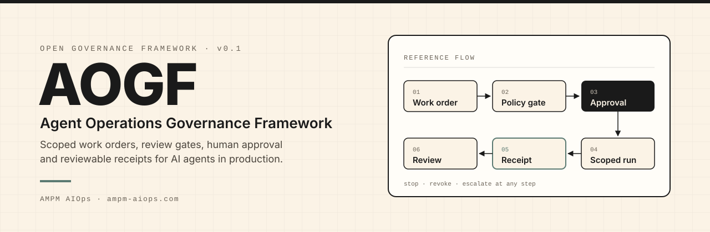
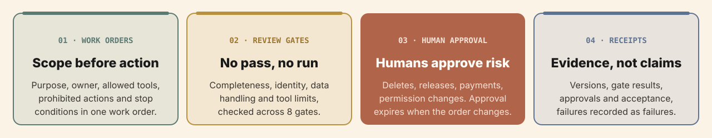
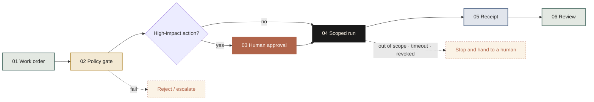
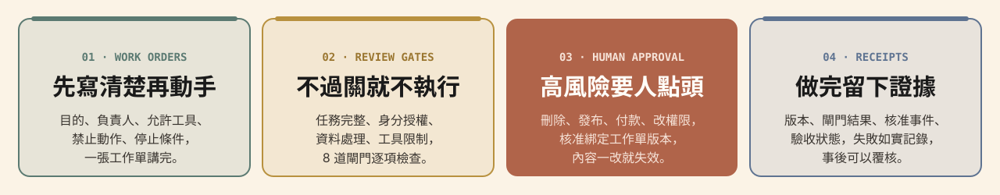
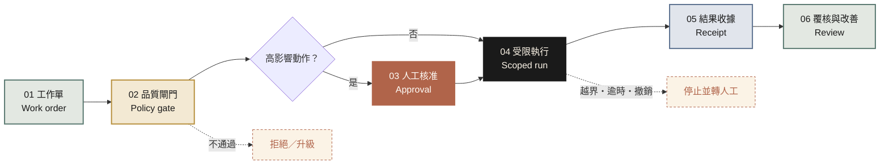
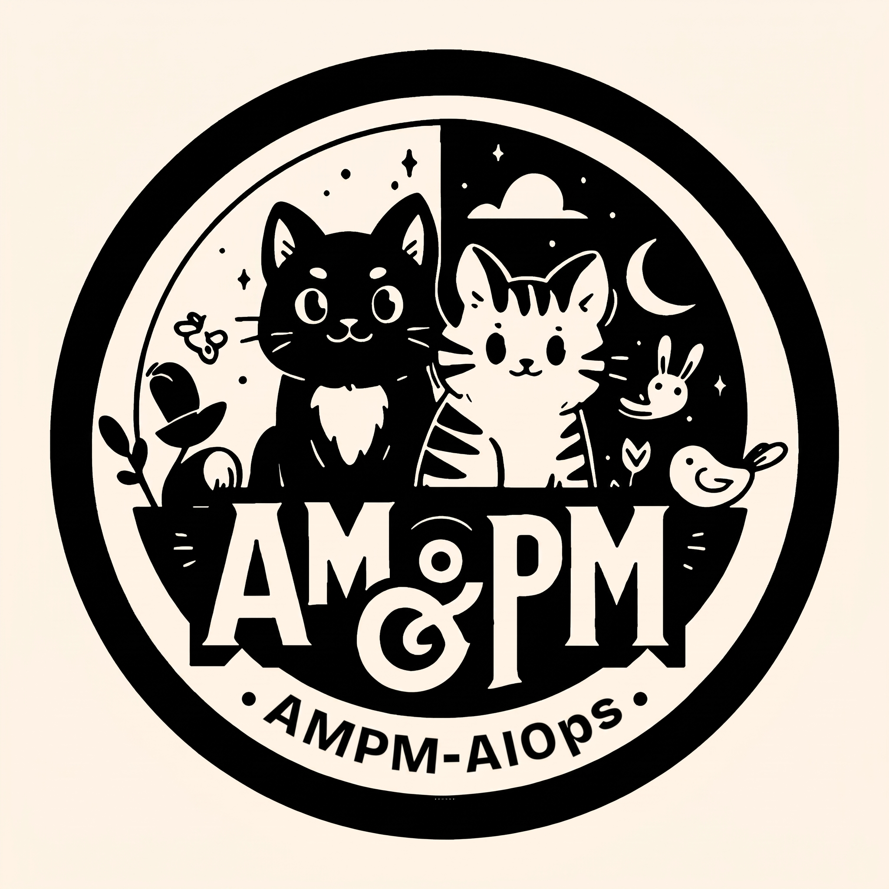

  

  
  
  
  
  

  <a href="#05--quick-start">Quick start</a> ·
  <a href="docs/architecture.md">Architecture</a> ·
  <a href="docs/work-order-lifecycle.md">Work-order lifecycle</a> ·
  <a href="docs/quality-gates.md">Quality gates</a> ·
  <a href="docs/receipts-and-audit.md">Receipts &amp; audit</a>

<b>English</b> · <a href="#zh-tw">繁體中文 ↓</a>

# AOGF — Agent Operations Governance Framework

**Before an AI agent touches production, it has a scope, an owner, an approval and a stop condition. After it acts, it leaves a record you can review.**

AOGF is a **vendor-neutral governance whitepaper** with blank templates. It turns *who asked, what is allowed, who approved, when to stop and how to accept the result* into concrete work orders and checkpoints, so engineering, platform and security teams can govern AI agents in one shared language.

> [!IMPORTANT]
> **This repository contains a whitepaper and a blank framework only.**
>
> | Included | Not included |
> |---|---|
> | Framework guidance: roles, lifecycle, checkpoints, record fields | Any executable code, tool or hosted service |
> | Blank work-order and receipt templates (every field empty) | Any organization's rule text, thresholds or internal procedures |
> | A usage guide and one high-level case study of how the authors apply the framework | Operational details of that deployment |
> | Design principles and stated limitations | Third-party certification, compliance attestation or performance guarantees |
>
> Use the framework to fill in your own team's rules, permissions and acceptance criteria. It tells you **which fields and checkpoints should exist**; it does not decide their content for you, and it does not enforce any control on its own.

  

> [!TIP]
> **Live MVP — one system, three parts.** This framework is the governance system behind our AI-tool site **[ampm-aiops.com](https://ampm-aiops.com/?utm_source=github&utm_medium=readme&utm_campaign=aogf)**, which AI agents run under it every day. Its output — open AI-tool pricing data, every row with an official source URL and a last-verified date — is published in **[awesome-ai-tools-pricing](https://github.com/AMPM-AIOPS-HQ/awesome-ai-tools-pricing)**.

## What's new in v0.2

v0.2 adds what running the framework taught us. Nothing from v0.1 is removed.

| Area | Added |
| --- | --- |
| Lifecycle | Scope triage (when a work order is required), automations under pre-approved task lists, no orphan work orders, cancellation records, policy updates and work in progress |
| Quality gates | Three review seats, reliability requirements for the gates themselves, limits on AI reviewers, format checks versus fact checks |
| Receipts | A receipt for every run including failed ones, the journey record, incident notes that become candidate checks |
| Architecture | The control plane is human-change-only |
| New documents | [Usage guide](docs/usage-guide.md), [case study](docs/case-study.md), [changelog](CHANGELOG.md) |

## 01 · Who it is for

> Your AI agents **read data, call tools or change external systems**, and you are accountable for the outcome.

| Role | What you care about | What AOGF gives you |
|:--|:--|:--|
| **Platform / infrastructure engineer** | Permission boundaries, recoverability | Work-order fields, tool allowlists, stop conditions |
| **Engineering lead** | Who requested it, who owns it, who answers when it breaks | Ownership and approval flow, state-transition rules |
| **Security / audit** | Privilege escalation, data leakage, after-the-fact investigation | Gate checklist, receipt fields, record-minimization principles |

## 02 · The problem

| ✕ Common practice | What goes wrong | ✓ AOGF approach |
|:--|:--|:--|
| Permissions live in the prompt | The model promises to touch one file; the runtime never enforces it | **Runtime-enforced scope**: a work order is not a source of privilege |
| One approval, valid forever | The task changes; the old approval is still used | **Approval bound to a version**: any material change invalidates it |
| The agent reports "done" | Failures get recorded as success | **Independent acceptance**: success, partial and failure recorded separately |
| No consistent record format | Nobody can answer who, when and what changed | **Fixed receipt fields**: sample and review afterwards |

## 03 · What you get

| Document | In one line |
|:--|:--|
| 📐 [`docs/architecture.md`](docs/architecture.md) | Six logical roles, trust boundaries, core principles |
| 🔁 [`docs/work-order-lifecycle.md`](docs/work-order-lifecycle.md) | `draft → submitted → approved → running → completed` state machine and revocation rules |
| 🚦 [`docs/quality-gates.md`](docs/quality-gates.md) | Minimum checks for 8 gates, failure handling, pre-pilot test list |
| 🧾 [`docs/receipts-and-audit.md`](docs/receipts-and-audit.md) | Recommended receipt fields, the journey record, incident notes that prevent repeats, hashes vs. signatures |
| 🧭 [`docs/usage-guide.md`](docs/usage-guide.md) | Step-by-step adoption for one workflow, with weak-versus-strong examples |
| 🔎 [`docs/case-study.md`](docs/case-study.md) | How the authors run it, what failed, and the trade-offs accepted |
| 📝 [`examples/work-order.example.yaml`](examples/work-order.example.yaml) | Blank work-order template |
| 📄 [`examples/receipt.example.json`](examples/receipt.example.json) | Blank receipt template |

## 04 · Reference flow

> [!NOTE]
> This is a **reference** governance flow. The repository provides documents and templates only; it does not deploy anything or enforce any control. Actual protection depends on your runtime, permission system and operating procedures.

## 05 · Quick start

> [!TIP]
> Start with **one** workflow that has external effects but can be rolled back, for example opening pull requests, updating documentation or triaging tickets.

| Step | What to do | File |
|:--:|:--|:--|
| **1** | State purpose, owner, allowed tools, prohibited actions, acceptance and stop conditions, expiry | [`work-order.example.yaml`](examples/work-order.example.yaml) |
| **2** | Walk through each gate; decide what the runtime enforces and what needs human approval | [`quality-gates.md`](docs/quality-gates.md) |
| **3** | Run once; record versions, gate results, approval events and acceptance status | [`receipt.example.json`](examples/receipt.example.json) |
| **4** | Sample receipts against real outcomes; tighten permissions and policy before widening scope | [`receipts-and-audit.md`](docs/receipts-and-audit.md) |

## 06 · Design principles

| Principle | Meaning |
|:--|:--|
| **Enforce in the runtime, not in the prompt** | A work order is a human-approved boundary, not a way for the model to gain privilege |
| **Bind approval to a version** | A material change to the work order invalidates its approval |
| **Reversible first** | Low-impact, recoverable steps first; irreversible actions need separate approval |
| **Record failure as failure** | Success, partial completion and failure are kept apart; the agent's own report is never the only evidence |
| **Minimize records** | Receipts never contain credentials, private keys, full sensitive prompts or unnecessary personal data |

## 07 · Scope and limitations

> [!CAUTION]
> - AOGF is **not** an agent runtime or a hosted service, and it is **not a third-party certification or proof of compliance**.
> - A SHA-256 hash can show that content matches a known digest; it is **not a digital signature**, and append-only logs are not absolutely tamper-proof.
> - Test results apply only to the documented environment, versions and scenarios; simulations do not represent production behavior.

## 08 · Contributing, security and license

| Topic | Details |
|:--|:--|
| Contributing | See [CONTRIBUTING.md](CONTRIBUTING.md): use fictional examples; never include real customers, credentials or internal paths |
| Security | See [SECURITY.md](SECURITY.md): do not post exploitable details in public issues |
| Docs and templates | CC BY-SA 4.0 ([LICENSE-DOCS.md](LICENSE-DOCS.md)) |
| Code | Apache-2.0 ([LICENSE-CODE.md](LICENSE-CODE.md)); no code is included yet |
| Brand | Brand names, trademarks and logos are not licensed under the above |

---

<a href="#aogf--agent-operations-governance-framework">English ↑</a> · <b>繁體中文</b>

# AOGF：AI 代理營運治理框架（白皮書）

**讓 AI 代理動到生產系統之前，先有範圍、有人核准、有停止條件；動完之後，留下可以覆核的紀錄。**

AOGF（Agent Operations Governance Framework）是一份**不綁定模型或供應商**的治理白皮書，附空白模板。它把「誰交辦、能做什麼、誰核准、什麼時候必須停、做完怎麼驗收」寫成可落地的工作單與檢查點，讓工程、平台與資安團隊用同一套語言管理 AI 代理。

> [!IMPORTANT]
> **這個儲存庫只有白皮書與空白框架。**
>
> | 有 | 沒有 |
> |---|---|
> | 治理框架說明（角色、流程、檢查點、紀錄欄位） | 任何可執行的程式、工具或服務 |
> | 空白的工作單與收據模板（欄位都是空的） | 任何組織的規則原文、門檻或內部程序 |
> | 使用說明，以及一份作者自身運作的高層次案例 | 該運作環境的操作細節 |
> | 設計原則與範圍限制 | 第三方認證、合規證明或效果保證 |
>
> 你可以照這個框架，填入自己團隊的規則、權限與驗收條件。框架只告訴你「該有哪些欄位與檢查點」，**不替你決定內容，也不替你執行任何控制**。

  

> [!TIP]
> **實際運作中的 MVP：一套系統、三個部分。** 這套框架就是我們 AI 工具站 **[ampm-aiops.com](https://ampm-aiops.com/?utm_source=github&utm_medium=readme&utm_campaign=aogf)** 背後的治理系統，網站每天由 AI 代理在這套系統下運作。它的產出——公開的 AI 工具價格資料，每一筆都附官方來源與查核日期——公開在 **[awesome-ai-tools-pricing](https://github.com/AMPM-AIOPS-HQ/awesome-ai-tools-pricing)**。

## v0.2 新增了什麼

v0.2 加入的是實際運作這套框架之後學到的事。v0.1 的內容沒有移除。

| 範圍 | 新增 |
| --- | --- |
| 生命週期 | 先分類（什麼時候需要工作單）、自動化作業依預先核准的任務清單、不留孤兒工作單、取消紀錄、政策更新與進行中的工作 |
| 品質閘門 | 三個審查席位、閘門本身的可靠性要求、AI 審查員的界線、格式檢查與事實檢查 |
| 收據 | 每次執行（含失敗）都有收據、過程紀錄、會變成候選檢查的事故紀錄 |
| 架構 | 控制面只有人能改 |
| 新文件 | [使用說明](docs/zh-TW/usage-guide.md)、[運作案例](docs/zh-TW/case-study.md)、[版本紀錄](CHANGELOG.md) |

## 01 · 適用對象

> 你的 AI 代理會**讀資料、呼叫工具或改動外部系統**，而你要對結果負責。

| 角色 | 你在意的事 | AOGF 給你的 |
|:--|:--|:--|
| **平台／基礎設施工程師** | 代理的權限邊界、出錯能不能回復 | 工作單欄位、工具白名單、停止條件 |
| **工程主管** | 誰交辦、誰負責、出事找誰 | 責任人與核准流程、狀態轉換規則 |
| **資訊安全／稽核** | 越權、資料外洩、事後追查 | 品質閘門清單、收據欄位、紀錄最小化原則 |

## 02 · 要解決的問題

| ✕ 常見做法 | 後果 | ✓ AOGF 的做法 |
|:--|:--|:--|
| 權限寫在提示文字裡 | 模型說「只改這個檔」，環境卻沒擋 | **執行環境強制**，工作單不是權限來源 |
| 核准一次就一直有效 | 任務改了，舊核准還在用 | **核准綁定版本**，內容一改就失效 |
| 只看代理自己說「完成了」 | 失敗被當成成功 | **獨立驗收**，成功、部分完成、失敗分開記 |
| 沒有一致的紀錄格式 | 事後答不出誰、何時、改了什麼 | **固定收據欄位**，可抽樣覆核 |

## 03 · 你會得到

| 文件 | 一句話 |
|:--|:--|
| 📐 [`docs/architecture.md`](docs/zh-TW/architecture.md) | 六個邏輯角色、信任邊界、核心原則 |
| 🔁 [`docs/work-order-lifecycle.md`](docs/zh-TW/work-order-lifecycle.md) | `draft → submitted → approved → running → completed` 狀態機與撤銷規則 |
| 🚦 [`docs/quality-gates.md`](docs/zh-TW/quality-gates.md) | 8 道閘門的最低檢查、未通過處置、試行前測試清單 |
| 🧾 [`docs/receipts-and-audit.md`](docs/zh-TW/receipts-and-audit.md) | 收據建議欄位、過程紀錄、能阻止重犯的事故紀錄、雜湊與簽章的界線 |
| 🧭 [`docs/usage-guide.md`](docs/zh-TW/usage-guide.md) | 一條流程的逐步導入，附「寫得弱／寫得強」對照 |
| 🔎 [`docs/case-study.md`](docs/zh-TW/case-study.md) | 作者自己怎麼運作、出過什麼問題、接受了哪些取捨 |
| 📝 [`examples/work-order.example.yaml`](examples/work-order.example.yaml) | 工作單空白模板 |
| 📄 [`examples/receipt.example.json`](examples/receipt.example.json) | 收據空白模板 |

## 04 · 參考流程

> [!NOTE]
> 這是治理**參考流程**。本儲存庫只提供文件與模板，不執行部署、也不替你強制任何控制；實際防護取決於你的執行環境、權限系統與作業程序。

## 05 · 快速開始

> [!TIP]
> 先挑**一條**會產生外部影響、但可以回復的流程試做，例如自動開 PR、更新文件、整理工單。

| 步驟 | 做什麼 | 用哪個檔 |
|:--:|:--|:--|
| **1** | 寫明目的、負責人、允許工具、禁止動作、驗收與停止條件、有效期限 | [`work-order.example.yaml`](examples/work-order.example.yaml) |
| **2** | 逐項對照閘門，分清哪些由環境強制、哪些要人工核准 | [`quality-gates.md`](docs/zh-TW/quality-gates.md) |
| **3** | 執行一次，記錄版本、閘門結果、核准事件、驗收狀態 | [`receipt.example.json`](examples/receipt.example.json) |
| **4** | 抽樣比對收據與實際結果，調整權限與政策後再擴大範圍 | [`receipts-and-audit.md`](docs/zh-TW/receipts-and-audit.md) |

## 06 · 設計原則

| 原則 | 意思 |
|:--|:--|
| **環境強制，不靠自律** | 工作單是人類核准的邊界，不是模型取得權限的來源 |
| **核准綁定版本** | 工作單實質變更，核准即失效 |
| **可逆優先** | 先做低影響、可回復的步驟；不可逆動作另需核准 |
| **失敗如實記錄** | 成功、部分完成、失敗分開記，不以代理自述作為唯一證據 |
| **紀錄最小化** | 收據不放憑證、私鑰、完整敏感提示或非必要個資 |

## 07 · 範圍與限制

> [!CAUTION]
> - AOGF **不是**代理執行平台、不是託管服務，也**不構成第三方認證或合規證明**。
> - SHA-256 雜湊可檢查內容是否一致，但**不是數位簽章**；附加式紀錄也不等於絕對防竄改。
> - 測試結果只適用於記錄下來的環境、版本與情境；模擬測試不代表生產環境表現。

## 08 · 參與、安全與授權

| 項目 | 說明 |
|:--|:--|
| 修訂建議 | 見 [CONTRIBUTING.md](docs/zh-TW/CONTRIBUTING.md)：使用虛構範例，勿放入真實客戶、憑證或內部路徑 |
| 安全回報 | 見 [SECURITY.md](docs/zh-TW/SECURITY.md)：勿在公開議題張貼可利用細節 |
| 文件與模板授權 | CC BY-SA 4.0（[LICENSE-DOCS.md](LICENSE-DOCS.md)） |
| 程式碼授權 | Apache-2.0（[LICENSE-CODE.md](LICENSE-CODE.md)；目前尚未包含程式碼） |
| 品牌 | 品牌名稱、商標與標誌不在上述授權範圍內 |

---

   
  AmPm AiOps Co., Ltd. · 黑曜智體有限公司

